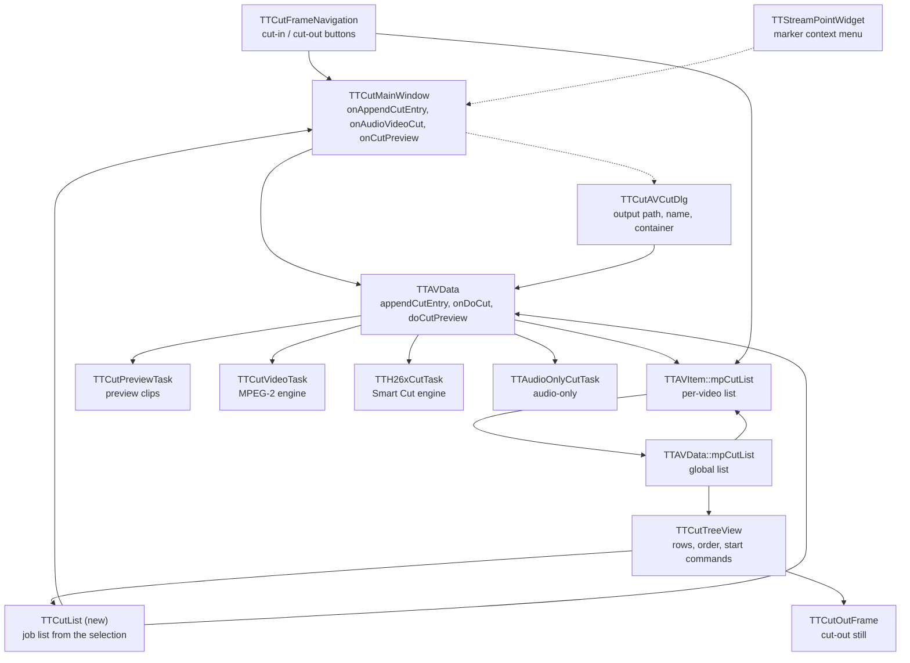

# Code Map: Editing and starting a cut

From the user's gesture to the moment a cut task is handed its job: where a
cut range comes from, the **two** cut lists it lives in, how the tree view
turns a selection into a job list, what the start dialog contributes, and
what each of the three engines receives.

**Neighbours, not part of this map:** the engines themselves
([mpeg2-cut.md](mpeg2-cut.md), [smart-cut.md](smart-cut.md)), the audio
timing chain ([audio-cut-timing.md](audio-cut-timing.md)), the progress
brackets ([progress-reporting.md](progress-reporting.md)), where markers come
from ([stream-points.md](stream-points.md)), what the dialog writes into the
settings ([settings-state.md](settings-state.md)), and the preview player's
internals ([playback.md](playback.md) covers `TTCutPreview` as a second
user of the mpv stack).

Legend: solid = data, dashed = trigger only.

## Edge semantics

| from → to | data / order / invariant carried |
|---|---|
| `TTCutFrameNavigation` → `TTCutMainWindow::onAppendCutEntry` | `addCutRange(cutIn, cutOut)`, emitted by `onAddCutRange` only when **both** positions were set since the last append; the two labels reset to "..." and the flags clear before the signal. The positions are display-order stream indices, taken from `currentPosition` at the moment the button was pressed — the widget never re-reads the stream. |
| `TTStreamPointWidget` → `onStreamPointSetCutIn` / `SetCutOut` | Trigger only: the marker's frame index moves the current frame (`currentFrame->onGotoFrame`), then `navigation->onSetCutIn()/onSetCutOut()` reads the position back out of the navigation widget — and does nothing while its button is disabled (the cut-point rule, gate `marker_cutpoint`). The marker index never reaches the cut list directly. |
| `onAppendCutEntry` → `TTAVData::appendCutEntry` | `(mpCurrentAVDataItem, cutIn, cutOut)` — the **current** item (a click on a cut row makes that row's item current: `onCutSelectionChanged` → `onChangeCurrentAVItem`). Wrapped in a `try` for `TTInvalidOperationException`, which `canCutWith` raises. |
| `TTCutOutFrame` / `TTCurrentFrame` → `TTAVItem::updateCutEntry` | The two still frames move one end of the **selected** cut as the user steps through frames, writing after every step. Each stops once it reaches the other end of that range; without a selected cut they only navigate. |
| `TTCutFrameNavigation` → `TTAVItem::mpCutList` | The edit branch of `onAddCutRange`: with `isEditCut` set it calls `editCutData->avDataItem()->updateCutEntry(*editCutData, cutInPosition, cutOutPosition)` on the item the edited entry belongs to, deletes its copy and returns. Like every `updateCutEntry` caller, this write reaches a cut list without passing `TTAVData` — no `canCutWith`, no exception handler (`updateCutEntry` checks with `isValidCut` and refuses and logs), and the global list learns of it only through `itemUpdated`. |
| `TTAVData::appendCutEntry` → `TTAVItem::appendCutEntry` | Before appending, `canCutWith` runs against every **other** item of `TTAVList` (it returns at once when handed the item itself): equal frame rate, same audio-track count, same stream type, matching audio bitrate/samplerate/version, and for MPEG-2 the sequence headers of both videos at their own cut positions. `TTAVItem::checkCut` then rejects a negative or inverted range, and a cut-out beyond the frame count once a stream is open. |
| `TTAVItem::mpCutList` → `TTAVData::mpCutList` | `itemAppended` / `itemRemoved(const TTCutItem&)` / `itemUpdated` are wired in `createAVItem` to the global list's `onAppendItem` / `onRemoveItem` / `onUpdateItem`. The per-item list is the **content** source; entries enter the global list in the order the item emits them. |
| `TTAVData::mpCutList` → `TTAVItem::mpCutList` | The reverse edge carries **order only**: `orderUpdated` → `onUpdateOrder` writes the new `mOrder` back into the item's copy. Reordering therefore originates in the global list, content does not. |
| `TTAVData::mpCutList` → `TTCutTreeView` | `itemAppended` → `onAppendItem` builds one row with six columns (file, cut-in, cut-out, length, drift placeholder, hint) and asks for a repaint of the cut overview bar (`refreshDisplay`, [navigator-window.md](navigator-window.md)). Row *i* of the tree and `TTAVData::cutItemAt(i)` are the same entry — the view keeps no item of its own and re-reads the model by position. |
| `TTCutTreeView` → job `TTCutList` | `cutListFromSelection(ignoreSelection)` fills a list from `newJobCutList()` with `(avDataItem, cutIn, cutOut)` per row — either all rows or the selected ones. The view owns that list: starting the next job frees the previous one, the destructor the last. The four-argument `append` leaves `order` at its default `-1` for every entry, so a job list carries no usable order. |
| job list → `onCutPreview` / `onAudioVideoCut` | `previewCut(list, skipFirst, skipLast)` and `audioVideoCut(audioOnly, list)`. `skipFirst`/`skipLast` mark neighbour clips that `onEntryPreview` added for transition context and that the preview must not present as selected cuts. |
| `onAudioVideoCut` → `TTCutAVCutDlg` | Trigger only. Before the dialog opens, the encoder codec is set from **`mpCurrentAVDataItem`'s** stream type and a still-empty `cutVideoName` is derived from that stream's file name (plus `_cut` when `cutAddSuffix`). |
| `TTCutAVCutDlg` → `TTSettings` → `TTAVData` | On Start only (`onDlgStart` → `setGlobalData`, `done(Accepted)`): output directory, suffix flag, container and the encoder values. `getCommonData` strips the **UI** container extension and re-attaches the codec's **ES** extension, so `cutVideoName` leaves the dialog as the intermediate elementary-stream name (`architecture_cutvideoname_split`). `TTSettings::save()` runs after Accepted, never after Cancel. |
| job list → `TTAVData::onDoCut` | `(tgtFileName, cutList, audioOnly)`; `tgtFileName` is `cutDirPath` + `cutVideoName` joined absolutely. A null list falls back to the global list; `mpRunningCutList` records which one this operation runs on, because `onCutFinished` needs the same list the muxer read its codec and frame rate from. |
| `onDoCut` → `doAudioOnlyCut` / `doH264Cut` / MPEG-2 branch | Three-way switch: `audioOnly` first, then `cutList->isH26xCut()` — which asks the **first entry's** stream type. Every branch, the audio-only one included, reaches its engine only after `confirmCutWarnings(cutList)` (audio bursts and MPEG-2 aspect changes at cut edges) returned true; a refusal ends the operation with a `Finished` bracket and the text "Cut cancelled". |
| `onDoCut` → `TTCutVideoTask::init` | `(tgtFilePath, cutList)` — the MPEG-2 task keeps the list itself and walks it entry by entry, taking the video stream of each entry's own `avDataItem()`. The frame rate, the `.info` timing and the audio tracks cut beside it are read in `onDoCut` from `cutList->at(0).avDataItem()`. |
| `doH264Cut` → `TTH26xCutTask::init` | A flat `TTH26xCutParams`: source path, targets, frame rate, A/V offset, codec and PAFF flags, `cutFrames` (display-order pairs from `frameRanges()`), the seconds-based `keepList` and the display-order map. The list itself does not travel — everything was resolved from entry 0 plus the ranges. |
| `doAudioOnlyCut` → `TTAudioOnlyCutTask::init` | `TTAudioOnlyCutParams`: target name, the same seconds-based keep list, acmod normalisation flag, the audio-only output format and `workingMuxDeleteES` (as `deleteTrackFiles`) copied **at dispatch time**, and the pre-computed `.mka` path. |
| `TTAVData::doCutPreview` → `TTCutPreviewTask` | The job list is handed to the constructor and kept as `mpCutList`; the task builds its **own** `mpPreviewCutList` in `operation()` and owns only that one. The pool is initialised with `cutList->count()*2` steps. |
| `TTCutTreeView` → `TTCutOutFrame` | `itemUpdated` → `onCutOutChanged`: the cut-out still follows the edited entry. There is no edge back: changing an entry goes through `onEntryEdit` → `entryEdit` → `TTCutFrameNavigation::onEditCut`, which writes via `TTAVItem::updateCutEntry`. |

## Assumptions and contracts

- **Two lists, two responsibilities.** Every `TTAVItem` owns a cut list; `TTAVData` owns a global one that mirrors all of them. Content flows upward, order flows downward. Anything that reads "the cut list" in the GUI means the global one.
- **Entry 0 is the source of record.** Frame rate, audio tracks, `.info` timing and the codec switch are read from `cutList->at(0).avDataItem()` by `onDoCut`, `doH264Cut` and `doAudioOnlyCut`; the video stream too, except in the MPEG-2 engine, which takes each entry's own stream (`TTCutVideoTask::operation`). A job list is a sequence of ranges, not a sequence of sources — `canCutWith` is what makes that safe, and it runs at append time against the AV list, not at start time against the job list.
- **Positions are display-order stream indices** end to end (`frame-order.md`); `frameRanges()` hands exactly those pairs to the Smart Cut engine.
- **A cut range is only complete when both ends were set.** `onAddCutRange` is the sole gate; it clears both flags, so the next range starts empty.
- **Edit mode bypasses the main window.** With `isEditCut` armed, `onAddCutRange` calls `editCutData->avDataItem()->updateCutEntry(...)` directly and returns — the `addCutRange` signal is not emitted and `TTAVData::appendCutEntry`, with its `canCutWith` check, never runs. `updateCutEntry` validates through `isValidCut` itself and, on a bad range, refuses and logs instead of raising.
- **The view moves first, the model follows.** `onEntryUp`/`onEntryDown` re-order the tree rows themselves and report `itemOrderChanged(old, new)` afterwards, which swaps the global list. Row *i* ↔ `cutItemAt(i)` only holds while both stay in step.
- **The producer owns the job list.** `newJobCutList()` is the single allocation point; an operation always ends before the next starts, so freeing the previous job at the next one is safe.
- **Cancel changes nothing.** The start dialog persists settings only on Accept, and `onDlgStart` refuses to accept while the output file exists unless the overwrite question is answered with Yes.

## Known pitfalls

- **A refused range change is only visible in the log.** Both write paths validate through `isValidCut`, but `appendCutEntry` raises (`onAppendCutEntry`, `onEntryDuplicate` and `TTCutProjectData::parseCutSection` catch; `TTAVData::copyCutEntry` appends the copy to the row's own video, `cutItem.avDataItem()`, so a duplicate keeps a range its video has — gate `duplicate_cut`) while `updateCutEntry` refuses and logs — its six calling functions run inside Qt slots, where an escaping exception ends the application. The three gestures that could hit the limit stop at the other end before getting there, so the refusal is a last line of defence rather than something a user meets. `TTCutItem::cutLengthFrames` takes the absolute difference, so an inverted range would still report a plausible length.
- **A cut list never validates what it is handed.** `TTCutList::append`/`update` store whatever they get; every check lives one level up in `TTAVItem`. `remove` guards against an entry it does not hold, as `update` and `onUpdateOrder` do.
- **The two `append` overloads disagree about `order`.** `append(const TTCutItem&)` assigns `count()` when the order is negative and announces it; `append(avItem, cutIn, cutOut, order = -1)` stores whatever it got. Every job list goes through the second one, so all its entries carry `-1` — `sortByOrder()` on such a list is `std::sort` over equal keys and not stable.
- **The codec is decided twice from two different places.** `onAudioVideoCut` sets the encoder codec from `mpCurrentAVDataItem`, the dispatch in `onDoCut` switches on `cutList->isH26xCut()`, which asks entry 0. `canCutWith` keeps them in step, because it rejects a differing stream type: `TTAVData::appendCutEntry` runs it per new cut, and for a project — whose loader appends its cuts while the streams are still opening — `TTAVData::onReadProjectFileFinished` runs the same rule over every cut once all streams are in (`findIncompatibleVideos`) and ends the load as aborted when it fails. Gate: `project_incompatible`.
- **`clear()` emits two removal signals per entry** — the `TTCutItem` overload and the index overload — because the global list and the tree view listen to different ones.
- **`onEntryUp`/`onEntryDown` re-order while iterating.** Up walks the rows front to back, down back to front, and each selected row moves by one with its own `itemOrderChanged`; the direction keeps the rows not yet visited at their indices, and the loop restores the current item and the selection afterwards. With the first (up) or last (down) row selected nothing moves, unless an edit is active.
- **`canCutWith` only bites with more than one video.** The caller walks the whole AV list, so with one video loaded the item is handed itself; it returns at once in that case. It has to — its MPEG-2 half reads its own side at the positions of the item's existing cut entries, so comparing a file with itself would pit two places of that file against each other, and a recording whose aspect ratio changes would be refused. That check also needs the existing item to already hold cut entries.
- **A failed cut also emits `cutFinished`.** Since the headless `--auto-cut` route must not hang, telling success from failure is the receiving slot's job — `onCutFinished` checks `lastCutError()` first.

## Redundancy / consolidation candidates

- **five start commands, two booleans**
  - sites: `gui/ttcuttreeview.cpp:TTCutTreeView::onEntryCut`, `:onAVCut`, `:onAVSelCut`, `:onAudioCut`, `:onAudioSelCut`
  - shared purpose: emit `audioVideoCut(audioOnly, cutListFromSelection(ignoreSelection))` — the five differ only in the two flags
  - status: consolidate → one slot taking the two flags, or two thin wrappers; the menu/action layer already knows which combination it wants
- **current-row lookup**
  - sites: `gui/ttcuttreeview.cpp:TTCutTreeView::onEntrySelected`, `:onItemSelectionChanged`, `:onGotoCutIn`, `:onGotoCutOut`
  - shared purpose: guard, then turn the current row into its entry
  - status: done `91e088ff` (audit run 6, batch E) — `currentCutIndex()` holds both and states the row↔entry contract once
- **"no data" guard in the tree view**
  - sites: `onEntryPreview`, `onPreview`, `onEntryEdit`, `onEntryDuplicate`, `onEntryCut`, `onAVCut`, `onAVSelCut`, `onAudioCut`, `onAudioSelCut`, `onContextMenuRequest` (`mpAVData == 0` → return)
  - shared purpose: every command needs a model
  - status: deliberate → ten one-liners; `TTCutMainWindow::navigationEnabled` already disables the list and the buttons through `TTCutTreeView::controlEnabled` while no video is open (all but `pbCutAudioSelected`, which `controlEnabled` does not touch), so the guards are a second line, not the only one
- **range validation on the two write paths**
  - sites: `data/ttavlist.cpp:TTAVItem::appendCutEntry`, `data/ttavlist.cpp:TTAVItem::updateCutEntry`
  - shared purpose: a cut range entering the list
  - status: done `91e088ff` (audit run 6, batch A2) — `isValidCut` decides for both; `checkCut` raises on top of it for the appending path, `updateCutEntry` refuses and logs because its callers are slots
- **source resolution from entry 0**
  - sites: `data/ttavdata.cpp:TTAVData::onDoCut`, `:doH264Cut`, `:doAudioOnlyCut`
  - shared purpose: video stream, frame rate, audio tracks and `.info` timing of "the" source
  - status: consolidate → one accessor returning the job's source item plus its timing, so the entry-0 assumption is stated once rather than repeated in each branch

## Ways into a cut list besides the GUI gesture

- **Project loader.** `TTCutProjectData::parseCutSection` calls `TTAVItem::appendCutEntry` directly — no `canCutWith`, and while the streams are still opening `isValidCut` cannot test the frame-count bound (`videoStream()` is still 0). A range `checkCut` rejects is skipped with a warning; `TTAVData::onReadProjectFileFinished` runs `canCutWith` over all cuts once the streams are in.
- **VDR import.** `TTAVData::onOpenVideoFinished` turns pending VDR markers into cuts through `avItem->appendCutEntry`, after its own filter (`cutIn >= 0 && cutOut > cutIn`, `cutOut` capped at `frameCount - 1`).
- **Headless `--auto-cut`.** `TTCutMainWindow` (`ttcutmainwindow_headless.cpp`) hands `mpAVData->cutList()` — the global list, no job list — to `onDoCut`, so no job list is allocated on that route.
