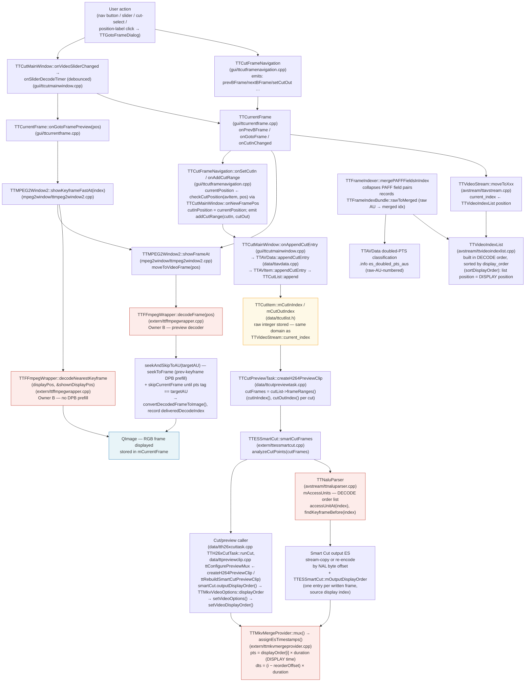

# Code Map: Frame-Order Pipeline

**Scope:** In which frame-order domain (decode order vs display order) does each
component work, and where do the still-image display path and the Smart Cut
execution path diverge? The central diagnostic question is: why does the Cut-In
still-image preview show a different frame than the one that ends up in the output?

## Data flow



## Edge semantics

One row per boundary in the diagram. The order-domain column is the critical fact.

| From → To | What crosses | Order domain |
|---|---|---|
| `TTFrameIndexer::mergePAFFFieldsInIndex` → `TTFrameIndexBundle::rawToMerged` → `TTH26xVideoStream::mapRawAuToDisplayIndex` | **A third index domain, distinct from both decode and display order:** `TTFrameIndexer::build` scans **one packet per raw AU** (PAFF top and bottom field are separate packets); the merge then collapses each field pair, so the bundle's `index` is *merged*. `.info` fields written by ttcut-demux (`es_doubled_pts_aus`) are numbered in **raw** AUs and must be translated before they can be compared against anything TTCut shows. Encoding: entry ≥ 0 → merged index; entry < 0 → collapsed bottom field with merged index `~entry`; empty vector = identity. `rawToMerged`, `gops` and the display map are computed once, by `TTFrameIndexer::build()`, and then travel with the bundle wherever it goes — `TTH26xVideoStream::mFrameIndexBundle` is the canonical copy `mapRawAuToDisplayIndex()` reads, and `TTFFmpegWrapper::frameIndexBundle()` hands back the SAME whole bundle it adopted via `setFrameIndex()` (`avstream/ttframeindex.h`: a wrapper "stores the adopted bundle whole and re-exports it unchanged"), `rawToMerged`/`gops` included. `TTFFmpegWrapper` itself exposes no `rawPacketCount()`/`rawToMergedIndex()`/`rawIsCollapsedField()`; raw-AU translation goes through `TTFrameIndexBundle`'s methods of the same name, called via the owning `TTH26xVideoStream` (`rawAuCount()`, `mapRawAuToDisplayIndex()`, `rawAuIsCollapsedField()`), which is the only caller (`TTAVData`, `.info` doubled-PTS classification). `mapRawAuToDisplayIndex(raw)` is `rawToMergedIndex(raw)` followed by `decodeToDisplayIndex(merged)`, so it returns a **display** index (-1 for a raw index out of range or a merged frame without display slot, e.g. a dropped HEVC RASL picture; a collapsed bottom field maps to its top field's frame — callers test `rawAuIsCollapsedField` first). | **RAW AU order** on the input side (one entry per demuxed packet); **merged decode order** out of `rawToMerged`; **DISPLAY order** out of `mapRawAuToDisplayIndex` (after `decodeToDisplayIndex`) |
| `TTH26xVideoStream::frameIndexBundle` → `TTFFmpegWrapper::setFrameIndex(const TTFrameIndexBundle&)` | PAFF flag, `frame_mbs_only_flag` and `log2_max_frame_num` travel **inside** the adopted index as one `TTFrameIndexBundle`. The two SPS values come from `TTNaluParser::parseH264SpsBasics` (called by `TTFrameIndexer::parseH264SpsFromExtradata`), which reads the de-escaped SPS through the shared walk `ttParseH264SpsHeader`; an over-long POC cycle or an SPS that ends before the flag leaves `frame_mbs_only_flag` unknown (`haveFrameMbsOnlyFlag = false`); an SPS that ends before `log2_max_frame_num` makes the call fail. Adopters never run the index pass themselves, so without them the decode-order tagging counts PAFF field packets as whole frames: `decodeFrame()` then never reaches a field-pair target AU and drains the file to EOF (measured 2×53 s in `46d3dcb1`; **recurred** through the quick-jump path and was measured again at 72 675 ms vs 13 ms, spec 2026-08-28). `setFrameIndex(bundle)` is the only entry point and stores the bundle whole (`mBundle = bundle`), so index, metadata and display map cannot be separated. | n/a — carries stream properties, not indices; but it decides whether the adopter's **decode-order** tagging is correct |
| `TTCurrentFrame::eventFilter` (click on the position label) → `TTGotoFrameDialog` → `onGotoFrame(selectedFrame, 0)` | Dialog inputs are `videoStream->currentIndex()`, `frameCount()` and `frameRate()`; the spin box clamps to `0..frameCount-1`, and the timecode field converts with `frame / fps` — the same `frame / fps` arithmetic the position label uses (`frameTime()` → `ttFramesToTime`); the label truncates the milliseconds while the dialog rounds them, so the last digit can differ by 1 ms. **The dialog introduces no domain conversion of its own:** the number it returns re-enters through `onGotoFrame` → `moveToIndexPos`, i.e. exactly the path the slider takes, so it inherits whatever domain the navigation index already has. Guard difference worth knowing: `ttFramesToTime` silently substitutes 25 fps when `fps < 1`, while the dialog refuses the conversion at `fps <= 0` and leaves the timecode field empty (the frame spin box stays usable) | same domain as every other navigation index — **DISPLAY order** (all codecs) |
| `TTCutFrameNavigation::onSetCutIn()` → `cutInPosition` | `currentPosition` — the integer last stored by `checkCutPosition(avData, pos)`; copied into `cutInPosition`. The slot returns at once while the cut-in button is disabled (the `isCutInPoint` rule set by `checkCutPosition`). No signal is sent (only `setCutOut` exists, connected in `TTCutMainWindow`); the range reaches the cut list through `onAddCutRange` → `addCutRange(cutIn, cutOut)` (see the `mCutInIndex` row) | **DISPLAY order** |
| `TTVideoStream::moveToXxx()` → caller (TTCurrentFrame, TTCutOutFrame) | return value = `current_index` = position in `TTVideoIndexList` | **DISPLAY order** for all codecs (the list is `sortDisplayOrder()`-sorted at open: `TTOpenVideoTask`) |
| `TTVideoIndexList::moveToNextIndexPos(pos, type)` → TTVideoStream | next list position ≥ pos+1 matching frame type (any type when `frame_type <= 0`; `-1` when none) | **DISPLAY order** for all codecs — H.26x: list built from `TTH26xVideoStream::mFrameIndexBundle.index` with `display_order` from the display map, then `sortDisplayOrder()` (see the `TTVideoIndexList (H.26x)` assumption below); MPEG-2: sorted by `display_order` (`temporal_reference`) via `sortDisplayOrder()` |
| `TTCurrentFrame` → `TTMPEG2Window2::showFrameAt(newFramePos)` | integer `newFramePos` — the return value of the `moveTo*` call | **DISPLAY order** (all codecs) |
| `TTMPEG2Window2::moveToVideoFrame(iFramePos)` → `TTFFmpegWrapper::decodeFrame(iFramePos)` | integer `iFramePos`, passed on unchanged to the wrapper's `decodeFrame()`, which treats it as a display position and maps it to a decode-order AU of `mBundle.index` (Owner B; the adopted `TTFrameIndexBundle`) via `displayToTargetAU()` | **DISPLAY order** in; the AU lookup inside the wrapper is in decode order (`mBundle.index` was built by `TTFrameIndexer` scanning packets sequentially) |
| `TTCutMainWindow::onVideoSliderChanged(sPos)` → `onSliderDecodeTimer()` (debounced, gui/ttcutmainwindow.cpp) | `sPos`, held in `mPendingSliderPos`; every intermediate `valueChanged` during a drag is coalesced, only the newest survives to fire once the debounce timer elapses | same domain as every other slider position — **DISPLAY order** (all codecs), unchanged by debouncing |
| `onSliderDecodeTimer()` → `TTCurrentFrame::onGotoFramePreview(sPos)` (while `slider()->isSliderDown()`) vs. `onGotoFrame(sPos, …)` (on release) | `sPos` — same integer, routed to the fast preview path only while the handle is still held; the release always takes the exact `onGotoFrame` path (`TTSettings::fastSlider()` chooses `fast` 0/1 there, orthogonal to this preview/exact split) | same domain as the value carried |
| `TTCurrentFrame::onGotoFramePreview(pos)` → `TTMPEG2Window2::showKeyframeFastAt(pos)` | `pos` as-is (same value `onGotoFrame` would receive) | **DISPLAY order** (all codecs) — same domain as `showFrameAt` |
| `TTMPEG2Window2::showKeyframeFastAt(index)` → `TTFFmpegWrapper::decodeNearestKeyframe(index, &shownDisplayPos)` [H.26x branch] | `index` interpreted the same way `decodeFrame`'s `frameIndex` is — a **display** position when the display-order map is valid (`displayToDecode()` converts to AU before the backward keyframe walk), else a raw decode-order `mBundle.index` slot | **DISPLAY order** in, when the map is valid |
| `TTMPEG2Window2::showKeyframeFastAt(index)` → `moveToVideoFrame(index)` [MPEG-2 branch] | `index`, unconverted — MPEG-2's decoder is cheap enough per frame that the fast path is just the ordinary `moveToVideoFrame` call, not a distinct keyframe-only decode | **DISPLAY order** (MPEG-2 list is already `sortDisplayOrder()`-sorted) |
| `TTFFmpegWrapper::decodeNearestKeyframe(displayPos, &shownDisplayPos)` → caller | `QImage` of the keyframe **at or before** `displayPos` (backward walk over `mBundle.index[].isKeyframe` in decode order from the mapped AU), plus `shownDisplayPos` = that keyframe's own display position (`decodeToDisplay(keyAU)`, or `keyAU` verbatim when the map is invalid) — **not** `displayPos` itself. `showKeyframeFastAt` propagates `shownDisplayPos` as its own return value, and callers (`onGotoFramePreview`) resync `videoStream`/`currentCutPosition` to that value, not the originally requested one. Decoded with `mSearchMode` forced true for the duration of the call (borrows the search path's no-DPB-prefill seek — safe because a keyframe is self-decodable) and saved/restored around it. Shares the `mFrameCache`/`mFrameCacheLRU` LRU cache with `decodeFrame()`, keyed by display position, so a keyframe already shown by either path is free on repeat | **DISPLAY order** out (`shownDisplayPos`); the returned frame is the nearest keyframe, not necessarily the requested position |
| `TTFFmpegWrapper::decodeFrame(n)` → caller | `QImage` shown in the still-image widget | **`n` is a DISPLAY position.** `decodeFrameInternal` maps `n` to `targetAU = displayToTargetAU(n)` (via the display-order map when valid, else identity) and decodes via `seekAndSkipToAU` until the delivered frame's `pts` tag equals `targetAU` — not by counting N decoder outputs. The shown content is therefore the true display frame n, matching what the Smart Cut engine would cut at display position n (WYSIWYG). |
| `TTFFmpegWrapper::decodeFrame(n)` → `mBundle.index[n].deliveredDecodeIndex` | the DECODE-order AU actually delivered for display position n | set as `index[n].deliveredDecodeIndex = targetAU` on a successful decode — exact by construction, since `targetAU` is also the loop's stop condition |
| `TTCutFrameNavigation::onSetCutIn()` / `onAddCutRange()` → `TTCutMainWindow::onAppendCutEntry` → `TTAVData::appendCutEntry` → `TTAVItem::appendCutEntry` → `TTCutList::append` → `TTCutItem::mCutInIndex` | `cutInPosition` / `cutOutPosition` (copies of `currentPosition`) as plain `int`, emitted by `addCutRange(cutIn, cutOut)` | **DISPLAY order** (same value that TTCurrentFrame received from `moveTo*`) |
| `TTCutItem::cutInIndex()` → `TTCutList::frameRanges()` → `TTCutPreviewTask::createH264PreviewClip` | `mCutInIndex` | **DISPLAY order** |
| `TTCutPreviewTask` → `TTESSmartCut::smartCutFrames(cutFrames)` | `QList<QPair<int,int>>` of (cutIn, cutOut) integer positions | **DISPLAY order** — `analyzeCutPoints` converts to AU via `mDisplayMap.displayToDecode()`; `seg.startDisplay/endDisplay` hold the display positions, `seg.startFrame/endFrame` the derived AUs. |
| `TTESSmartCut::analyzeCutPoints` → `TTNaluParser::accessUnitAt(index)` | `index` into `mAccessUnits` | **DECODE order** — TTNaluParser builds its AU list in bitstream order (no POC reordering); `TTAccessUnit::index` is a sequential counter, not a POC-sorted display position |
| `TTNaluParser::accessUnitPtr(index, size)` → Smart Cut write path | byte offset + size of NAL units at decode position `index` | **DECODE order** → byte position in file (correct for stream-copy) |
| `TTCutFrameNavigation::checkCutPosition(avData, pos)` ← `TTCutMainWindow::onNewFramePos(pos)` | explicit `pos` parameter; stored as `currentPosition` | **DISPLAY order** (same pos returned by `moveToXxx` in TTCurrentFrame) |
| `TTCurrentFrame::onPlayVideo()` → `mPlayer->load(…, startSec)` (H.26x: via `startPlaybackFromTempMkv()`) | `startSec = playbackSecondsForCurrentStill()`: MPEG-2 `(idx − extrasBefore(idx)) / fps`; H.26x with a display-PTS temp MKV (`mTempPlaybackHasDisplayPts`) `decodeToDisplay(deliveredDecodeIndex) / fps`; H.26x linear fallback `deliveredDecodeIndex / fps`, and `idx / fps` when `deliveredDecodeIndex` is -1 | **DISPLAY order** — `deliveredDecodeIndex` is the decode tag of the frame actually shown; the display map turns it into the display time the temp MKV carries as PTS |
| `TTESSmartCut::streamCopyFrames/reencodeFrames/bufferAndWriteEncoderPacket` → `TTESSmartCut::mOutputDisplayOrder` (via `appendOutputDisplay`) | one `mDisplayMap.decodeToDisplay(au)` value appended per written frame, in ES write order (call sites: `streamCopyFrames` for stream-copy — bulk-write and per-frame paths — and `bufferAndWriteEncoderPacket` for encoder packets via `ctx.encodeAuOrder`) | **DISPLAY order** (source-domain, absolute) — `ctx.encodeAuOrder` is filled in `reencodeFrames`, capturing each submitted frame's source AU (`AVFrame::pts`) at submission time so it survives `runEncodePass()` freeing `framesToEncode`; with `bf=0` the encoder returns packets 1:1 in submission order, so `ctx.packetsReceived` indexes `encodeAuOrder` correctly even though most x264 packets only arrive during `flushEncoder()` |
| `TTESSmartCut::outputDisplayOrder()` → caller (`TTH26xCutTask::runCut`; `ttConfigurePreviewMux` for the preview clips) → `TTMkvVideoOptions::displayOrder` → `TTMkvMergeProvider::setVideoOptions()` → `setVideoDisplayOrder()` | `QVector<int>` — source display indices re-numbered to a compact, gap-free, order-preserving RANK (sort + `QHash` rank lookup) | **DISPLAY order**, output-local (segments leave gaps in source display numbering, so the absolute source index is not usable as a packet-count-based array index in the muxer) — returns an **empty** `QVector` (fallback) on: a negative `decodeToDisplay()` result (HEVC dropped-RASL slot, guarded in `appendOutputDisplay`), more encoder packets than submitted frames (`bufferAndWriteEncoderPacket`), or a duplicate source display index (`outputDisplayOrder`) — all three warn loudly via `TTMessageLogger` |
| `TTMkvMergeProvider::assignEsTimestamps(in)` | `pkt->pts = displayOrder[frameCount] × frame duration`; `pkt->dts = (frameCount − reorderOffset) × frame duration` — each computed in ns (`frameDurNs`) and rounded on its own to the 1 ms output time base (rounding the duration once drifted 1.1 % at 29.97 fps, gate `mkv_framerate`) | **PTS: DISPLAY order (true display time); DTS: approximated decode order** — `reorderOffset = max(i − displayOrder[i])` over the whole list (computed once in `setupVideoInput`) so `dts ≤ pts` always holds by lowering DTS, never raising PTS (raising PTS would shift video against the untouched audio streams); a resulting negative start DTS is normalized by `avoid_negative_ts` across **all** muxed streams together, not just video. Called once per output **frame** (`in.frameCount`) — PAFF field pairs are merged into one call by `processPAFFFieldPair()` first, matching `TTNaluParser`'s own field-pair merge 1:1 in count. Empty `displayOrder`: for an MPEG-2 video `TTMkvMergeProvider::mux()` first derives it from the bitstream's `temporal_reference` (`buildMpeg2DisplayOrder`; an empty result when its self-check fails keeps the linear stamping). For H.26x it stays empty when the Smart Cut run was invalidated, or in the playback temp MKV: `TTCurrentFrame::buildPlaybackMuxParams` fills `displayOrder` (applied by `TTPlaybackMuxTask::operation` via `setVideoOptions` → `setVideoDisplayOrder`) **only** for an H.26x stream with a valid display map — an invalid/empty H.26x map leaves it empty, see the display-PTS bullet under *Redundancy*. The empty case falls back line-for-line to the linear `pts = dts = frameCount × frameDur` stamping |

## Assumptions, contracts & pitfalls

- **`TTVideoIndexList` (H.26x)** — built from `mFrameIndexBundle.index` in decode order (one entry per AU, `headerListIndex == decode AU`); `display_order` is the POC display rank from the bundle's map (`vidIndex->setDisplayOrder(decodeToDisplayIndex(i))` in `createIndexList`), and AUs without a display slot (dropped HEVC RASL pics, rank < 0) are skipped so `frameCount()` equals the decoder's output count. `sortDisplayOrder()` at open then makes list position == display position, the same semantics MPEG-2 gets from `temporal_reference`.

- **`TTVideoIndexList` (MPEG-2)** — `sortDisplayOrder()` IS called after building the list; the list is then sorted by the `display_order` field from the MPEG-2 picture headers. Navigation then walks in display order. `current_index` and all returned positions are display-order indices.

- **`TTFFmpegWrapper::decodeFrame(n)`** — assumes: `n` is a DISPLAY position (mapped via `displayToTargetAU()` to a decode-order AU in `mBundle.index`, the adopted `TTFrameIndexBundle`, when the display-order map is valid; identity otherwise). Guarantees: returns the QImage of the true display frame n (see "Root cause & knot" below for the mixed-index defect this replaced). The caller (`TTMPEG2Window2`) and the cut-list agree on this domain: both pass display positions.

- **`TTCutItem::mCutInIndex / mCutOutIndex`** — assumes: stores whatever integer TTCurrentFrame had as `currentPosition` at the moment the user pressed Set Cut-In / Set Cut-Out. No conversion is performed. For every codec this is a display position (navigation is display-order). `TTESSmartCut::analyzeCutPoints` converts it to a decode-order AU via `mDisplayMap.displayToDecode()` before it reaches `TTNaluParser::accessUnitAt()`, which only takes decode-order AU indices.

- **`TTNaluParser::mAccessUnits`** — assumes: populated in bitstream (decode) order. `TTAccessUnit::index == decodeIndex` (a sequential decode-order counter), NOT a POC-sorted display index (the header comment "display order based on POC" is wrong). **POC is NOT computed at all (verified 2026-06-08): `currentAU.poc` is hard-set to `-1` everywhere; `pic_order_cnt_type` is read from the SPS but no per-frame POC is derived.** So there is currently no display-order information available from the parser without either implementing POC or a decode pass. An access unit ends at an AUD or at a slice with `first_mb_in_slice == 0` **only once it holds a slice**; NAL units collected without one (an AUD + SEI whose slice lost its start code) stay and open the next access unit — the split libav's parser makes, so parser and `TTFrameIndexer` count the same pictures (gate `au_without_slice`). `findKeyframeBefore(n)` and `findKeyframeAfter(n)` scan linearly in decode order. Display order is not derived here; it comes from `TTDisplayOrderMap` (built from the libav parser's `output_picture_number`).

- **`TTFFmpegWrapper::seekToFrame(n)`** — does NOT seek to the keyframe of the GOP that displays at position n. `n` is a decode-order AU index into `mBundle.index`: it seeks to the keyframe of the GOP that **decodes at or before** AU n (one further keyframe back unless `mSearchMode` is set, for DPB prefill). `decodeFrame` passes `targetAU = displayToTargetAU(displayPos)`, so the user-visible position is mapped before this call; seeking by a display position directly would land on the wrong GOP.

- **`TTFFmpegWrapper::skipCurrentFrame()`** — the send/receive pump the skip-loops in `decodeFrame`/`decodeFrameYUV`/`decodeNearestKeyframe` all drive one output at a time. Contract: on `avcodec_send_packet` returning `EAGAIN` (decoder output queue full — happens under a B-hierarchy), the packet is retained as `mPendingPacket` and a frame is drained via `avcodec_receive_frame` first — it is **never** discarded. The retained packet, already carrying its assigned decode-order tag (`decodeOrderTagForPacket`), is resent on the next call before any new packet is read from the file. Every call first tries `avcodec_receive_frame` before reading/sending anything, so output the decoder already buffered from a prior EAGAIN is taken as this call's result. `mPendingPacket` is freed (not resent) on `seekToFrame()` (a packet held from before the seek belongs to the pre-seek decode-order-tag domain — sending it into the just-flushed decoder would deliver one frame under a stale tag) and on `closeFile()`.

- **`TTFFmpegWrapper::seekAndSkipToAU(targetAU, displayIndex, caller)`** — the skip-loop body shared by `decodeFrame`'s and `decodeFrameYUV`'s non-sequential paths: `seekToFrame(targetAU)`, then a bounded `skipCurrentFrame()` loop until the delivered `pts` tag equals `targetAU`. Bound: `qBound(1, (targetAU − seekStart) + max(headroomEnd − targetAU, 256), index.size())`, where `headroomEnd` is the second keyframe past `targetAU` (or EOF) — reorder/field-pairing moves the target by at most a GOP, never by the length of the file. Polls `isCancelled()` (the wrapper's `mCancelToken`, set via `setCancelToken()`) once per output, returning `SeekSkip::Cancelled` immediately rather than continuing the loop.

- **`TTFFmpegWrapper::decodeNearestKeyframe(displayPos, &shownDisplayPos)`** — assumes: `displayPos` is a display position (mapped to AU via the display-order map when valid, else treated as a raw decode index, matching `decodeFrame`'s own fallback). Guarantees: returns the keyframe **at or before** the mapped AU, walking backward over `mBundle.index[].isKeyframe` in decode order — never the exact requested frame. `shownDisplayPos` is the display position of that keyframe, and it is the value callers must resync their own state to (`showKeyframeFastAt` returns it verbatim; `onGotoFramePreview` uses it, not the original `pos`, for `videoStream->moveToIndexPos()` / `currentCutPosition`). Pitfall: treating the return as "the frame at `displayPos`" is wrong by construction — it is a preview shortcut for slider-drag, paired with an exact `onGotoFrame()` call once the drag ends.

- **`deliveredDecodeIndex`** — lazily filled on first `decodeFrame()` call (stored at `mBundle.index[displayPosition]`, value `targetAU`); -1 until decoded. `playbackSecondsForCurrentStill()` (called from `onPlayVideo()` via `startPlaybackFromTempMkv()`) falls back to `currentIndex/frameRate` if -1, which points to the wrong time when B-frames are present.

- **`TTCurrentFrame::buildPlaybackMuxParams()`** (H.26x playback temp MKV) — requires `frameRate > 0`: after the `.info` fallback (`videoStream->frameRate()`, else the frame rate of `TTESInfo::timingForVideo()`) it bails, returning false so `startPlaybackMux()` logs "playback unavailable" and aborts the play, rather than compute `frameDurationNs = 1e9 / frameRate` with `frameRate == 0` (UB) — `25c966eb`. The mux itself runs in `TTPlaybackMuxTask` on `QThreadPool::globalInstance()`; `onPlaybackMuxFinished()` adopts the file and starts playback, `onPlaybackMuxAborted()` resets the buttons. Lifecycle: one file per mux (`ttcut-ng_playback_<pid>_<n>.mkv`) — a mux being discarded (`detachPlaybackMux()` → `TTPlaybackMuxTask::discard()`, on stream switch or widget destruction) may still be writing or removing its output while the next one starts; the finished file is reused across STOP→PLAY guarded by `playbackSourceFingerprint()`, and removed via `cleanupTempPlaybackFile()` both on cache-invalidation (source changed) **and** in the `TTCurrentFrame` destructor — so it is not left behind when the window is closed mid-playback.

- **`TTCutFrameNavigation::checkCutPosition(avData, pos)`** — receives an explicit `pos` parameter (the same value returned by `moveToXxx` in TTCurrentFrame) and stores it as `currentPosition`. An explicit `pos >= 0` wins; only the default `pos = -1` (callers such as `TTCutMainWindow::onSliderDecodeTimer`) falls back to `videoStream->currentIndex()`. `onSetCutIn()` emits `setCutIn(cutInPosition)` where `cutInPosition` equals the `currentPosition` set by the last `checkCutPosition` call.

- **`TTVideoStream::moveToNextPIFrame()` / `moveToPrevPIFrame()`** (avstream/ttavstream.cpp) — the P button (labelled "P/I") jumps to whichever of the next I- and next P-frame comes first. Each is obtained via a separate `moveToNextIndexPos`/`moveToPrevIndexPos` call (type I=1, type P=2), which returns **`-1` when no frame of that type follows/precedes**. The nearer hit is selected as the min (next) / max (prev) **only among valid (`>= 0`) positions**. Standing on the **last I-frame** (no further I → `pos_i == -1`) therefore still reaches the next P-frame, and the return guard `(index >= 0) ? … : current_index` keeps the position only when neither type follows. `moveToPrevPIFrame` handles `-1` the same explicit way. Note: this is a stream-boundary/sentinel concern only; it does **not** affect the decode-vs-display order domain of the returned index (see edge-semantics rows for `moveToXxx`).

## Root cause & knot — RESOLVED 2026-06-08 (two-harness empirical proof)

Verified with two standalone harnesses against the real code paths (`tools/diag/test_stillframe`
drives `TTESSmartCut::smartCutFrames`; `test_displaymap` drives `TTFFmpegWrapper::decodeFrame`; that harness was removed
in `fa3530a5`),
on MBAFF.264 around the 36384/36386 ad→programme transition.

**The knot (why decode-order index looks display-accurate) — SOLVED:**
- `TTFrameIndexBundle::index` and `mAccessUnits` are **both pure decode order** (`scanPacketsIntoRawIndex` appends in `av_read_frame` order, no PTS sort; position n = AU n). The map's "no off-by-N between the two index systems" holds.
- `decodeFrame(n)` only *appears* display-accurate because its skip-loop counts **decoder output (display order)**: it shows the frame at *display rank* (n − seekKeyframe). Navigation index n = decode position; shown content = display-rank frame. That mismatch is the whole problem.

**The bug (one line)** — in `selectFramesNonPAFF`, the function that `afdda3a`
renamed to `selectFramesByDisplayOrder`. Code as it stood before that commit:
```
int uiKeyframe    = mParser.findKeyframeBefore(ctx.startFrame); // AU/DECODE index
int displayOffset = ctx.startFrame - uiKeyframe;                // startFrame = DISPLAY index (per the startFrame contract in ttessmartcut.h)
```
Mixed index spaces: subtracting the keyframe's **decode index** from a **display index**. The
walk then counts `displayOffset` steps in display order from the keyframe's *display* position →
overshoots by (keyframe display-pos − keyframe decode-index) = the local reorder amount.
Cut-In display-36384 → realStartAU 36388 → output begins **~4 display-frames late** (inside programme).

**Falsified earlier hypotheses (do not reintroduce):**
- "~2 frames late": measured **~4**.
- "Open-GOP B-skip (`if (au < uiKeyframe) continue;`) is the cause": **FALSE** — harness showed `delta=0` between with-skip and no-skip walks; no `au<uiKeyframe` frames in the window.
- "POC parsed but not sorted": **FALSE** — POC is never computed (`currentAU.poc == -1` everywhere).

**`deliveredDecodeIndex`:** `decodeFrame` stops on the decoder output whose tag equals `targetAU` and stores exactly that `targetAU` for the display position, so the value is the true AU of the shown frame (not an accounting of seek/DPB-prefill delay).

| Path | What index N maps to | Consistent with display? |
|---|---|---|
| **Still-image display** (H.26x) | display position N → AU via `TTDisplayOrderMap` (`decodeFrame` / `displayToTargetAU`) | Yes (same map as the cut) |
| **Smart Cut** (H.26x) | display→AU via `TTDisplayOrderMap`; Cut-In 36384 → AU 36385 | **Yes** (fixed v0.72.0; cut-in + cut-out frame-accurate) |
| **Both** (MPEG-2) | `TTVideoIndexList` `sortDisplayOrder()`-sorted (via `temporal_reference`); paths agree | Yes (no bug) |

> **RESOLVED (cut-IN v0.72.0, cut-OUT 2026-06-19).** The mixed-index bug above is
> fixed. Cut positions are now **display positions** end to end, converted to AU via
> `TTDisplayOrderMap` (`avstream/ttdisplayordermap.{h,cpp}`), built from the libav
> parser's `output_picture_number` (no decode pass). `selectFramesByDisplayOrder`
> (renamed from `selectFramesNonPAFF`) selects by display position; the historical
> "Root cause & knot" analysis below is a point-in-time record, superseded by this.
>
> **Cut-OUT (frame-accurate, 2026-06-19) — `TTESSmartCut` tail re-encode:**
> `streamCopyFrames` copies a contiguous **decode-order** AU range, so B-frames that
> *display* after the cut-out but decode within the range must not leak in (extra
> trailing frames + accumulating A/V drift). `analyzeCutPoints` now pulls the
> stream-copy back to the last keyframe before the first display-late AU
> (`tailStartFrame`) and `processSegment` appends a **tail GOP re-encode**
> (`reencodeTail`, forced-IDR) that keeps only `display ≤ cutOutDisplay`. Partition
> per kept display position (exactly once): head re-encode `display ≥ startDisplay &&
> au < streamCopyLimit`; stream-copy `au < tailStart`; tail `au ≥ tailStart &&
> display ≤ endDisplay`; short segments fold to one pure re-encode bounded by both
> display limits. The stream-copy→tail-IDR transition is clean by IDR flush (no
> frameNumDelta/MMCO/SPS-unification needed). Each segment outputs exactly
> `cutOut − cutIn + 1` display frames; the audio keepList already expects that, so
> A/V sync is automatic (no audio change). Optimization: tail re-encode is skipped
> when the contiguous stream-copy is already frame-accurate. Verified: MBAFF full cut
> frame-exact (140411) + A/V 42 ms; PAFF improved vs baseline (deficit 7→3, A/V
> 376→232 ms; residual −3 = pre-existing seg-0 stream-start cut-IN, not the cut-out).

**Fix direction (decided 2026-06-08), implemented:** A — the cut lands on the frame the still shows,
through one authoritative display↔decode(AU) map, `TTDisplayOrderMap`, built by `TTFrameIndexer::buildDisplayMap()`
from the libav parser's POC. MPEG-2 has its display order from `temporal_reference`; the codecs stay
separate, only the index *semantic* (nav index = display position) is aligned. See `memory/project_stillframe_cut_offset.md`.

## HEVC RASL leading-pic alignment — RESOLVED 2026-06-21

The display↔decode map (`TTDisplayOrderMap`, POC-based, built since v0.72.0) was
ffmpeg/playback-aligned for H.264/MPEG-2 but **off by a constant for HEVC** (+7 on
`Ausdrucksstarke_Designermode.265`). Root cause: the first CRA (NAL 21) has
`NoRaslOutputFlag=1`, so its **RASL leading pictures** (NAL 8/9 — POC < CRA, decoded
after it) are dropped by every conforming decoder. The map still ranked them, putting
them at display 0..k-1 and shifting the CRA (the first actually-displayed frame) to
display k. ffmpeg/mpv drop them → map-display N == ffmpeg-display (N−k).

**Fix (Ansatz A — raw decode dimension kept, display dimension compacted):**
- `TTLeadingPicClassifier` (avstream/ttdisplayordermap.cpp) — stateful per-AU NAL-walk
  implementing the HEVC `NoRaslOutputFlag` rule (first IRAP / IRAP after a sequence
  end / BLA 16-18 / defensively IDR). "Sequence end" means **either** NAL type
  36 (`EOS`) **or** 37 (`EOB`) — the classifier arms on both, which matters because
  TTCut's own seam writes type 37. HEVC-only; H.264/MPEG-2 → always false. The
  dropped count is detected dynamically, never hardcoded.
- **Interaction with the HEVC RASL-preserving seam (2026-07-21):** that seam
  deliberately writes **no** EOB, so when its output is read back the classifier does
  not arm at the seam and keeps the copy-start CRA's RASL pictures in the display
  dimension. That is the correct result — the decoder now emits them too. The
  cold-start drop described here (first CRA of a file) is unaffected: it has no
  preceding sequence end either way. See `smart-cut.md`.
- `displayRanksFromPoc` skips entries flagged `isDroppedLeading` → `decodeToDisplay[i]=-1`
  (dropped AUs keep their raw decode slot but get no display position).
- `buildFromRanks` allows -1 holes; `displayCount()` (m = decodable frames) is exposed
  alongside `count()` (n = raw decode AUs). `displayToDecode` returns the **raw** decode
  AU, so the decode-tag match (`pts==targetAU`) in the decoders is unchanged.
- `decodeFrame` (still) and `decodeFrameYUV` (search) both map display→raw-AU via
  `displayToDecode` and bound on `displayCount()`. `createIndexList` skips AUs with
  `decodeToDisplayIndex(i)<0`, so `frameCount()` == m == the player frame count.
  `isCutInPoint`/`isCutOutPoint` bound on `frameCount()` (display space), not
  `accessUnitCount()` (raw n).

**Result:** still, search, the cut (`mDisplayMap.displayToDecode` in `selectFramesByDisplayOrder`),
and the navigable count all agree with ffmpeg/mpv display order. Verified: `decodeFrame(N)`/
search vs ffmpeg-display-N Pearson r≈1.0 (N=0 is the CRA); full HEVC cut output frame 0 ==
ffmpeg source display(cut-in) r=1.0, vs the old +k position r≈0.03. Gate:
`tools/diag/gate_hevc_align.sh`.

> **Supersedes** these earlier "Assumptions" bullets (pre-display-map era): "decodeFrame(n)
> returns display-frame n+reorderDelay" (now returns true display frame N via the map);
> "displayOrder(i)==i always for H.26x / setDisplayOrder(i)" (now `setDisplayOrder(disp)` from
> the map, dropped AUs excluded); "POC is NOT computed" (the map derives display ranks from
> libav parser POC). `playbackSecondsForCurrentStill()` (called by `onPlayVideo()`) converts the raw decode AU in
> `deliveredDecodeIndex` through `decodeToDisplay` when the playback temp MKV carries display PTS.

## H.264 open-GOP cold-start leading-pic alignment — RESOLVED 2026-07-05 (v0.72.1)

The RASL fix above dropped HEVC leading pics but `TTLeadingPicClassifier` is
**HEVC-only** (`H.264/MPEG-2 → always false`). A demuxed H.264 elementary stream
whose first coded picture is a **non-IDR open-GOP I-frame with leading pictures**
(`I B B B P …`, the leading Bs display before the I and reference a GOP before it
that does not exist at cold start) therefore mis-ranked those leading pics as
display 0..k-1. libav **drops** them (undecodable at stream start), so
`decodeFrame(display 0)` targeted an AU the decoder never emits → drained the whole
file to EOF (~11 min on 3.4 GB), then retried forever. **v0.72.0 regression** (the
pre-map `decodeFrame` counted decoder outputs and showed the first output = the I,
so it never hung). Real-world reach: any ZDF-neo / Das-Erste-HD 720p50 open-GOP
recording (measured 3 and 7 dropped pics respectively).

**Fix (POC-analytic, mirrors the HEVC drop but H.264 has no RASL NAL type):**
`TTDisplayOrderMap::markH264ColdStartLeadingPics(entries, codecId)`
(ttdisplayordermap.cpp) marks, for H.264 only and only at the first keyframe (cold
start), the contiguous run of AUs after it with `poc < keyframePoc` as
`isDroppedLeading`. Guards: no-op for non-H.264, for an IDR cold start (DPB-flushing,
self-contained → 0 drops), and for streams whose first trailing pic (`poc >=
keyframePoc`) immediately follows (→ 0 drops). Needs a keyframe anchor, so `TTPocEntry`
gained `bool key`, populated from `AV_PKT_FLAG_KEY` (buildFromFile) /
`TTFrameInfo::isKeyframe` (wrapper). Called in **both** build paths before `build()`:
`TTFrameIndexer::buildDisplayMap()` (ttframeindexer.cpp; until 2026-09-04
`TTFFmpegWrapper::buildDisplayOrderMap`, rebuilt per adopter) and
`TTDisplayOrderMap::buildFromFile()` — so still/search/nav and the cut path get the
same map. All downstream machinery (`displayRanksFromPoc` skips `isDroppedLeading`,
`displayCount()`, `createIndexList`, `decodeFrame`/`decodeFrameYUV`,
`selectFramesByDisplayOrder`) was already codec-agnostic and unchanged.

**Result:** `decodeFrame(0)` maps display 0 → AU 0 (the I), returns in ~8 s incl.
index build on the 3.4 GB file (was an 11-min hang). Gate `tools/diag/test_h264_leading`
(built map vs decoder ground truth): open-GOP 3 drops + 0 mismatches; 720p50 7 drops;
MBAFF 0 drops; Tux (IDR) 0 drops; HEVC RASL 7 drops (unchanged) — all aligned.

## Output-ES POC continuity & MKV display-PTS — done 2026-07-02/03

Two related fixes for decode-vs-display confusion downstream of the cut itself:
in the WRITTEN ES bitstream's own POC field (consumed by any external playback
decoder, not TTCut-ng's own index systems), and in the MKV muxer's packet
timestamps.

**1. Muxer PTS was decode-order, not display-order (pre-`b4f3ada`).**
`TTMkvMergeProvider::mux()` / `processPAFFFieldPair()` stamped every video
packet `pts = dts = frameCount × frameDur` — a purely linear, write-order
timestamp (`frameCount` counts output frames as written, not display
positions). That is correct for TTCut's own re-encoded segments (`bf=0`, no
reorder) but WRONG for stream-copied original GOPs that still contain
B-frames: their true display time differs from their write-order position.
Gate evidence (spec `docs/superpowers/specs/2026-07-03-es-mux-display-pts-design.md`,
gate G2): the legacy linear stamping produced 69262 PTS-monotonicity
violations on a 140419-frame MBAFF file; the fixed version produces 0 (frame
counts unchanged — G1 confirms the ES bytes themselves are bit-identical,
only the muxed timestamps change).

**Fix:** `TTESSmartCut::appendOutputDisplay()` (added in `09cc8e5`) records the
SOURCE display index (`mDisplayMap.decodeToDisplay(au)`) of every frame written
to the ES, in write order, at all three write sites (stream-copy bulk/per-AU in
`streamCopyFrames`, and encoder packets in
`bufferAndWriteEncoderPacket` via `ctx.encodeAuOrder` — the latter is filled by
`reencodeFrames`, capturing each submitted frame's source AU at *submission*
time, because `runEncodePass()` frees `ctx.framesToEncode` before most x264
packets actually arrive in `flushEncoder()`; with `bf=0` packets return 1:1 in
submission order so `ctx.packetsReceived` still indexes correctly).
`outputDisplayOrder()` (`b4f3ada`) compacts the recorded source indices into
gap-free output-local ranks (segments leave gaps in source display numbering).
`TTMkvMergeProvider::assignEsTimestamps()` then sets `pts = displayOrder[i] ×
duration` (true display time) and `dts = (i − reorderOffset) × duration`
(both computed in ns and rounded per packet), where
`reorderOffset = max(i − displayOrder[i])` (computed in `setupVideoInput`)
lowers DTS just enough that `pts ≥ dts` always holds — PTS is never raised,
since that would shift video against the untouched (unaltered) audio
streams; a resulting negative start DTS is normalized by `avoid_negative_ts`
across all muxed streams together. Any anomaly (negative display index from
a dropped HEVC RASL slot, more encoder packets than submitted frames, a
duplicate source display index, or a plain empty list — H.26x playback
temp MKV with an invalid display map) falls back line-for-line to the
pre-existing linear stamping; all fallbacks warn loudly via
`TTMessageLogger` except the plain-empty-list case, which is normal/expected
there. An MPEG-2 video gets its display order in the muxer itself
(`buildMpeg2DisplayOrder`, from `temporal_reference`).

**2. Rewritten encoder POC anchoring was wrong at the seam (`466497a`,
corrected by `88445b3`).** `TTESSmartCut::processSegment()` decides per-segment
— not just for PAFF as before — whether the H.264 non-PAFF stream-copy start
POC is reachable from the encoder's POC domain (`pocDomainBridgeable()`,
a free function in `extern/ttessmartcut.cpp`: same linear-distance rule
`applyPocDomainFix()` already used for its post-hoc patch search) and enables
per-segment SPS unification when it is not. Since `1893497`, the encoder POC
width feeding that decision is *measured*, not assumed: `probeEncoderPocParams()`
opens a throwaway libx264 context (`AV_CODEC_FLAG_GLOBAL_HEADER`, same
options `setupEncoder()` would use) before any segment is encoded and reads
`log2_max_poc_lsb`/`poc_type` from its SPS extradata; `processSegment` uses the
probed width only when the probe reports `poc_type==0`, otherwise it falls
back to the constant `kExpectedEncoderLog2PocLsb` (4) — which is in fact the
common case: measured (`b0e1335`) that libx264 with progressive `bf=0` picks
`poc_type=2` (no POC-LSB field at all; `poc_type=0` only appears with the
interlace flags this probe sets for MBAFF/PAFF sources), so the classic seam
still runs on the constant, now confirmed rather than assumed; the probe
reports that measured `poc_type!=0` fact as an `infoMsg`, not a warning.
`parseEncoderSpsFromPacket` (`6cb520b`) cross-checks the probe against each
segment's REAL encoder SPS (parsed from its first output packet's extradata)
and warns loudly (`log2_max_poc_lsb` and `poc_type` both compared) if the two
diverge. When unification runs for such a
seam, `reencodeFrames()` anchors the rewritten encoder POCs on
`mSpsUnificationPocAnchor`, computed in `processSegment` by scanning
`[streamCopyStartFrame, min(+16, nextKeyframe))` in DECODE order for the AU
with the MINIMUM `mDisplayMap.decodeToDisplay()` value
— i.e. the first frame the copy GOP actually *displays*, which is a leading
B-picture of the copy-start keyframe, not the keyframe itself (the keyframe's
own leading B-pictures decode after it but display before it and carry
SMALLER POCs). `base = (anchor − 2×N) mod srcMaxPocLsb`, computed in `reencodeFrames`,
then makes the encoder's LAST rewritten POC land directly below that anchor,
so a standards-compliant playback decoder's own output-reordering runs
monotonically across the seam instead of interleaving it (the original bug,
anchoring on the copy-start/keyframe POC directly, let the encoder's last
POCs land above/collide with the leading Bs — confirmed via `h264_analyze`
in spec `docs/superpowers/specs/2026-07-03-poc-anchor-min-display-design.md`,
which also documents that the EOS NAL preceding the copy-start AU is observed
to be packetized together with (swallowed into) the following copy-I packet
by the playback-side demuxer, so its DPB-flush has no effect there — making
correct POC *values* across the seam necessary regardless of the EOS).
The bridgeability CLASSIFICATION deliberately stays on the copy-start
(keyframe) AU's own POC only (in `processSegment`) — widening it to
the min-display POC would flag benign leading-B seams that the standard
(non-unification) path already bridges correctly (full-scan gate: 0
output-order violations, per the `88445b3` commit message). PAFF keeps the
pre-existing linear POC numbering (`mSpsUnificationPocAnchor = -1`) —
byte-identical output, unaffected by this fix.

> Both fixes address the same class of decode-vs-display divergence this map
> otherwise tracks for TTCut-ng's own navigation/cut-index systems
> (`TTDisplayOrderMap`, `TTFrameIndexBundle::index`, `mAccessUnits`) — here the affected
> "decoder" is an external playback decoder consuming the WRITTEN ES/MKV, but
> the mechanism (a decode-first AU is not the display-first AU) is identical.

## Redundancy / consolidation candidates

- **Frame-index construction** (`TTH26xVideoStream::createHeaderList` → `TTFrameIndexer::build()` → `mFrameIndexBundle`) and (`TTMPEG2Window2::openVideoStream` → Owner B `mpFFmpegWrapper`): Owner A → Owner B index sharing via `setFrameIndex(frameIndexBundle())` (Qt COW, O(1)). Every producer of an index is `TTFrameIndexer` and every entry into a wrapper is `setFrameIndex()`; the wrapper has no scan code of its own, but `adoptOrBuildFrameIndex()` runs a `TTFrameIndexer` itself when the bundle it is handed is empty. All adopters (preview window, search sub-decoders, frame search, quick-jump worker, analysis wrappers) take a `TTFrameIndexBundle`; `setFrameIndex(const TTFrameIndexBundle&)` is a one-line `mBundle = bundle` in `extern/ttffmpegwrapper.h`, there is no bare-list entry and no separate metadata setter.

- **Decode-order-to-display-order conversion**: PARTIALLY RESOLVED (`95da7f3`).
  `playbackSecondsForCurrentStill()` (used by `onPlayVideo`) is live and keys
  off `mTempPlaybackHasDisplayPts`: the playback temp MKV now carries TRUE
  display PTS (source display-order map passed to the muxer; dropped-RASL AUs
  parked behind the last real slot — they never render), so real frames
  satisfy pts == display index with no offset. The linear fallback branch
  keeps the pre-fix formula verbatim (invalid/empty map only). Measured:
  playback MKV output order 50% non-monotonic → 0.

- **MPEG-2 field-picture extra-index correction** lives in `TTMpeg2VideoStream`: `extrasBefore(index)` (stream index → display frame; used by `playbackSecondsForCurrentStill()`) and `streamIndexForDisplayIndex(displayIndex)` (the inverse; used through `TTCurrentFrame::displayToStreamIndex` by `onPlaybackFinished()` and `onPlaybackPositionChanged()`). Both count `mExtraIndices` (`ttCountBelow`); no duplicated logic remains.
