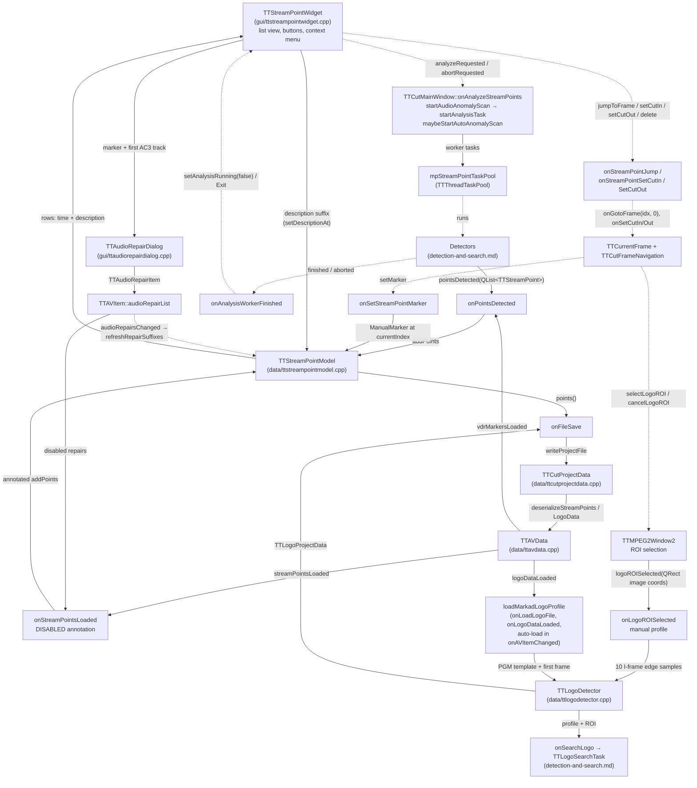

# Code Map: Stream points (Landezonen) in the main window

**Scope:** The consumer side of the stream-point ("Landezonen") feature: how
markers get into `TTStreamPointModel` (analysis dispatch and its result
slots, manual marker, project load, VDR/defect import), what the list widget
does with them (jump, cut-in/out, delete, audio repair), how they are saved,
and the logo profile (`TTLogoDetector`: manual ROI, markad PGM, project
round trip) that feeds the logo search. The detectors themselves — what a
worker scans, in which frame domain it reports, the cancel path — are
mapped in `detection-and-search.md`; this map starts where their
`pointsDetected` leaves them. The cut-time use of a planned audio repair is
in `audio-cut-timing.md`.

## Data flow

Solid edges carry data (producer → consumer); dashed edges are triggers
(signals/calls without a payload that matters here).

## Edge semantics

| From → To | What crosses (data / order / invariant) |
|---|---|
| `TTStreamPointWidget` → `onAnalyzeStreamPoints` | One button: `analyzeRequested` while idle, `abortRequested` while `mAnalysisRunning`. The widget writes no settings; every detection parameter comes from `TTSettings` (`spDetect*`, `spSilence*`, `spPillarbox*`, `audioAnomalyScanEnabled`, `anomaly*`), edited in the settings dialog's Stream Points category (`onStreamPointSettingsRequested` opens category 7 — the dialog owns that order). |
| `onAnalyzeStreamPoints` → `mpStreamPointTaskPool` | First `clearAutoDetected()` on the model (see below), then up to four tasks: `TTStreamPointVideoWorker` (needs a header list — MPEG-2 only), `TTAspectScanTask` (needs an index list; frame index taken from the preview wrapper), `TTAudioAnomalyScanTask` via `startAudioAnomalyScan` (needs an AC3 track — `TTAVItem::firstAc3TrackIndex`, the same rule the repair menu uses), `TTStreamPointAudioWorker` (first audio track). Every task goes through `startDetectorTask` (audit run 5): it connects the task's own `pointsDetected` to `onPointsDetected` and hands it to `startAnalysisTask`, which wires `finished` and `aborted` to `onAnalysisWorkerFinished` **and** to `deleteLater`, counts it in `mStreamPointWorkersRunning` and starts it on the pool. Enabled-but-impossible analyses are collected in `mSkippedAnalysisNotes` and shown/logged when nothing could start, or handed to the progress dialog's details. Re-entrancy guard: returns while `mStreamPointWorkersRunning > 0` (the headless screenshot mode can call it during an auto scan). |
| Detectors → `onPointsDetected` | `QList<TTStreamPoint>` with `frameIndex` in the **navigation (display) domain** (`detection-and-search.md`: positions from `moveToNext/PrevIndexPos`; the anomaly scan converts seconds with `videoFrameForTime`, extras included, and so does `TTStreamPointAudioWorker` for silence and audio-change markers — with the extra-frame list `onAnalyzeStreamPoints` passes it and, for a change, the `abs_frame_time` of the first header that leaves the old stable channel layout — one marker per layout switch, labelled `<main>.<lfe>` (audio-es-input.md). The two workers emit only when not aborted; `TTAudioAnomalyScanTask` emits an **empty** list on cancel and on an undecodable/non-48-kHz track; `TTAspectScanTask` emits its partial list on abort. One slot for every detector and for the imports below. |
| `TTAVData::vdrMarkersLoaded` → `onPointsDetected` | VDR marks (`VDRImportMarker`; `openAVStreams` queues them, `TTAVData::onOpenVideoFinished` emits them once the video stream is set) and the "Import as Stream Points" answer of the defect dialogs (`Error` markers, `showImportAsStreamPointsWarning`; among them one "Audio data error" marker per range `ttcut-audiofix` reported in the `.info`, from `TTAVData::audioCorruptionPoints`, which names the track by its file). Same slot as detector output, but these types are **not** `isAutoDetected()` — a later "Start analysis" keeps them. |
| `TTAVData::streamPointsLoaded` → `onStreamPointsLoaded` | The project's `<StreamPoint>` elements as parsed by `deserializeStreamPoints` (frame, type, description verbatim, confidence, duration; `AudioFrameFrom/To` only when both present and well-formed, `AudioChannels` only in 1…0x3F, `AnomalyKind` as `LfeBurst`/`LastingStop`/`Hole`/legacy `AbruptStop`, else unknown). Delivered in the fixed project-finished order after `currentAVItemChanged` (`stream-open-project-load.md`), so `mpCurrentAVDataItem` and the model's frame rate are set; `TTAVItem::resolveLoadedRepairs` (called from `TTAVData::onThreadPoolExit`, which runs before `onReadProjectFileFinished`) has by then turned the saved `<Order>` of each repair and donor into list positions, so the enabled flags the annotation reads are final. Before `addPoints`, every `AudioAnomaly` marker overlapping a **disabled** `TTAudioRepairItem` (range no longer fits the file, see `parseAudioSection`, or a donor fill whose donor track is missing) gets the "repair DISABLED" suffix chosen by `TTStreamPointWidget::disabledRepairSuffix` ("donor track is missing" for a fill without its donor among `donorCandidateTracks`, else "no longer fits the audio file"), with the "planned" suffix stripped first — both through `TTStreamPoint::hasSuffixVariant/stripSuffixVariant` over every known language variant, because the description is stored as plain text. Overlap uses `TTAudioRepairDialog::approxAc3RangeForMarker`: the marker's exact `AudioFrameFrom/To` when it carries one, else an estimate from `frameIndex` and duration (±1 AC3 frame). |
| `onSetStreamPointMarker` → model | `ManualMarker` at `videoStream()->currentIndex()`, triggered by the navigation panel's and the frame widget's `setMarker`. Description `tr("Marker (manual)")`; projects saved before `3ce254f4` carry the German literal `"Marker (manuell)"` verbatim (nothing matches on the base text, only the repair suffixes are language-tolerant). |
| `TTStreamPointModel` (all writers) | `addPoints` appends, **re-sorts by `frameIndex`** and resets the model; `addPoint` inserts sorted; neither deduplicates (`operator==` on frame+type exists but is unused by the model — the same finding twice is two rows). `clearAutoDetected` keeps `ManualMarker`, `VDRImportMarker`, `Error`. `setDescriptionAt` changes text only (no re-sort). `DisplayRole` = `hh:mm:ss` from `(frameIndex − extras before it) / mFrameRate` plus the description — frame rate and the extra frames (`setExtraFrameIndices`, the same `TTAVData::extraFrameIndices` list the widget gets: the MPEG-2 field-picture positions, for H.26x the .info doubled-PTS defects classified into display space) are set in `onAVItemChanged`, the extras cleared in `closeProject`; `ttCountBelow` does the subtraction, so the column shows the time the navigation display and the cut list show for that frame (gate `test_streampoint_model_time`); `Error` rows are painted red. |
| Model → `TTStreamPointWidget` | Plain `QListView` on the model. Status label after a run: "%1 stream points detected" counts **all** rows (manual and imported included), "Analysis cancelled – list incomplete" on abort. `setAnalysisRunning(true)` also sets the wait cursor; `false` restores it. |
| Detectors → `onAnalysisWorkerFinished` | Connected to both `finished` and `aborted` of every task; decrements the counter, and at zero calls `onStatusReport(Exit|Canceled)` itself so the progress dialog closes through the same chain as an open or a cut (`progress-reporting.md`) and the widget leaves the running state. `mStreamPointAnalysisAborted` is set by `onAbortStreamPoints` (pool-wide `onUserAbortRequest`). |
| Widget → `onStreamPointJump` | Double click (the context menu emits `jumpToFrame` only before it opens the repair dialog): `TTCurrentFrame::onGotoFrame(frameIndex, 0)` **deliberately not** `onVideoSliderChanged` — its second argument is a frame *type*, and with FastSlider on a marker landed on the next I frame instead of the marker. Then `checkCutPosition`. |
| Widget → `onStreamPointSetCutIn/SetCutOut` | `TTCurrentFrame::onGotoFrame(frameIndex)` (same as `onGotoFrame(frameIndex, 0)`, no `checkCutPosition` call of its own), then `TTCutFrameNavigation::onSetCutIn/onSetCutOut` — the buttons' slots; `newFramePosition` → `onNewFramePos` → `checkCutPosition` has updated the panel's `currentPosition` by then. The `isCutInPoint`/`isCutOutPoint` rule sets the enabled state of the two buttons in `checkCutPosition`, and `onSetCutIn`/`onSetCutOut` return at once while their button is disabled — so a marker on a frame that is no valid cut point sets nothing (gate `marker_cutpoint`). |
| Widget → `TTAudioRepairDialog` | Context menu on an `AudioAnomaly` marker only, and only while an AV item with an AC3 track is injected (`setAVItem`, `setExtraFrameIndices` from `onAVItemChanged`; cleared in `closeProject`). When `TTAudioRepairDialog::repairIndexForMarker` (`TTAVItem::findAudioRepairOverlapping` over the marker's approximate AC3 range) finds an existing `TTAudioRepairItem` on that track (the dialog uses the same lookup to prefill), the menu offers "Edit repair…" (for a donor fill only while the track has a donor candidate) and "Remove repair"; otherwise "Repair…", and only when `TTStreamPoint::offersNewAudioRepair()` says so or the marker is a `Hole` and `TTAVItem::donorCandidateTracks` is not empty. The widget emits `jumpToFrame` for the marker before the modal dialog opens (a right click does not navigate); the dialog has no jump of its own. "Delete"/"Delete all" use the same link: a marker with a repair is removed only together with it, after one question (audio-repair.md). Accepting strips a DISABLED suffix, then appends the "(repair planned)" suffix unless a variant is already there; removing strips the planned suffix. The repair itself lives in `TTAVItem::audioRepairList`, not in the marker. |
| `TTAVItem::audioRepairsChanged` → model (`TTStreamPointWidget::refreshRepairSuffixes`) | Emitted when a track-list change (not the repair dialog) renumbered, dropped or disabled repairs; the widget connects it in `setAVItem` (the item is held as `QPointer`). For every marker whose `repairIndexForMarker` repair is now disabled and which does not carry a DISABLED variant yet, the slot strips the "planned" suffix and appends `disabledRepairSuffix`, through `setDescriptionAt`. It only marks; a repair that became enabled again keeps the DISABLED text. |
| `onFileSave` → `TTCutProjectData` | `mpStreamPointModel->points()` — every row, auto-detected included — plus `TTLogoProjectData` (markad path **or** ROI rect, whichever made the profile) through `TTAVData::writeProjectFile`. `serializeStreamPoints` writes confidence and duration with two decimals, the AC3 range only when known, `<AudioChannels>` only for a non-zero channel mask and `<AnomalyKind>` only for a known kind. |
| `TTMPEG2Window2` → `onLogoROISelected` | Rubber band in widget pixels, mapped by `widgetToImageRect` to **image coordinates** (scaled by the shown pixmap's geometry, clipped to the frame), emitted only when both sides reach `TTLogoDetector::kMinRoiSide` (5) — a smaller drag keeps the selection open. The limit is in picture pixels, so on a small display one widget pixel can already exceed it: a plain click (no movement) emits a 6×6 area at a 310-px-wide picture (gate `logo_roi`). Selection mode is armed by the navigation panel's toggle (`selectLogoROI`) and drops itself after one selection. |
| `onLogoROISelected` → `TTLogoDetector` | `setROI`, then edge samples of up to 10 I frames forward from the current position (`moveToIndexPos(current, 1)` / `moveToNextIndexPos`), decoded through a dedicated analysis `TTFFmpegWrapper` for H.26x (`createAnalysisWrapper`: analysis mode, index adopted from the preview wrapper) or by moving the preview window for MPEG-2, then `finalizeProfile`: an edge pixel survives when it appeared in ≥ 70 % of the samples (Sobel magnitude > 30). Success is `hasProfile()` after `finalizeProfile`, not the number of decoded frames: `addEdgeSample` silently drops every frame while `hasROI()` fails (a side below `kMinRoiSide`) or the part inside the frame is below it (e.g. a saved area from another resolution), and then no profile exists. On success overlay and logo-search buttons go on; otherwise `clearProfile`, the overlay is removed, the buttons go off and the status says "Logo profile could not be created". |
| `loadMarkadLogoProfile` → `TTLogoDetector::loadMarkadLogo` | PGM `P5` with a `#C<corner>` comment; the template is placed flush into that corner of the **first decoded I frame's** resolution (no scaling: a PGM made for another resolution lands elsewhere). Returns false only on format/decode failure — there is no match test; the status text "Logo profile could not be loaded" says exactly that. One loader behind three entries: `onLoadLogoFile` (file dialog), the auto-load in `onAVItemChanged` (`<video>.logo.pgm` next to the file, deferred by a zero timer, with a frame-count progress in the status bar), and `onLogoDataLoaded` (project). Frames come from `createAnalysisWrapper` for H.26x (the visible still is not moved) and from the preview window for MPEG-2 (no libav wrapper exists; the still is restored afterwards). |
| `TTAVData::logoDataLoaded` → `onLogoDataLoaded` | `TTLogoProjectData` from `deserializeLogoData`: markad path (must still exist, else a 5-s status message and no profile) or a saved ROI, which re-runs `onLogoROISelected` — i.e. the manual profile is **rebuilt from the current material**, not restored. |
| `TTLogoDetector` → `onSearchLogo` | `hasProfile()` gates the search; the task gets the detector pointer and matches each frame's ROI edge map against the profile by NCC (`matchScore`). Search mechanics in `detection-and-search.md`. |
| `maybeStartAutoAnomalyScan` (three entry points) | Zero-timer from `onAVDataReloaded`, `onAVItemChanged` and `onOpenProjectFileFinished`; runs the scan when: enabled, no project load in progress, current item with video, `initialAudioLoadDone`, not yet `anomalyScanStarted`, no workers running, an AC3 track present, and **no `AudioAnomaly` marker already in the model** (then it latches `setAnomalyScanStarted` without scanning). The long comment above the function documents why one entry point was not enough (modal defect dialog stalls `onOpenVideoFinished`; the project load restores its markers after the pool exit). |

## Assumptions, contracts & pitfalls

- **Frame domain** — a marker's `frameIndex` is a navigation/display index for every codec; the time column subtracts the extra frames before it (MPEG-2 field-picture positions; for H.26x the classified doubled-PTS defects) like the playback does (`playback.md`), so model and navigation display agree.
- **`TTStreamPointModel`** — assumes callers pass display indices; guarantees sorted rows; pitfall: no deduplication, so a second "Start analysis" that finds the same points doubles them only if the first set survived — it does not, because `clearAutoDetected` runs first; imported (`Error`, `VDRImportMarker`) and manual rows are the ones that can accumulate.
- **`onAnalyzeStreamPoints`** — assumes the preview wrapper holds the frame index for H.26x (the pillarbox scan adopts it). Task lifetime is `startAnalysisTask`'s job: `TTThreadTask` has `setAutoDelete(false)` and the pool does not delete, so without its `deleteLater` wiring a task lives on. LeakSanitizer does not see such a leak (the signal connections keep the object reachable); the gate is `test_analysis_task_lifetime`, which drives `startAnalysisTask` with a finishing and an aborting dummy task.
- **`startAudioAnomalyScan`** — shared by the explicit analysis and the auto start; the explicit run scans again on purpose after `clearAutoDetected` dropped the earlier findings.
- **`onStreamPointsLoaded`** — the DISABLED annotation depends on `mpCurrentAVDataItem` being set (guaranteed by the project-finished order); the approximate range check is ±1 AC3 frame, fine for overlap, not for what a repair writes (the exact range travels in `AudioFrameFrom/To`).
- **Logo profile lifetime** — cleared in `onAVItemChanged` (every item switch), by "cancel ROI", and on a failed manual build; `closeProject` clears the marker model but not the profile or its overlay — they go with the next item switch. The logo search buttons are disabled by `navigationEnabled(false)` meanwhile.
- **Two decoders in the markad loader, by codec** — MPEG-2 has no libav wrapper, so `loadMarkadLogoProfile` decodes through the preview window (`moveToVideoFrame` + `grabFrameImage`), which moves the visible still and restores it at the end; H.26x uses `createAnalysisWrapper` and leaves the still alone.
- **Unknown `<Type>` in a project** — `TTStreamPoint::stringToType` maps every unknown string to `ManualMarker`: a marker written by a newer build with a type this build does not know comes back as a manual marker (survives `clearAutoDetected`, is saved back as `ManualMarker`). No warning.
- **Settings category index** — `onStreamPointSettingsRequested` opens category 7 by number; the dialog's constructor order is the contract.
- **Headless** — `runScreenshotMode` and `captureRepairDialogs` (screenshot set `repair`) call `onAnalyzeStreamPoints` directly and poll `mStreamPointWorkersRunning`; the re-entrancy guard exists for exactly that path (an auto scan may still be running).

## Redundancy / consolidation candidates

- **markad logo load**
  - sites: `gui/ttcutmainwindow.cpp:TTCutMainWindow::loadMarkadLogoProfile` (one site; entries `onLoadLogoFile`, `onLogoDataLoaded`, auto-load in `onAVItemChanged`)
  - shared purpose: decodeFn/nextIFn lambdas, `loadMarkadLogo`, overlay, `setLogoSearchEnabled`, status text
  - status: done `f2198216` (audit run 4, batch B) — the MPEG-2 path keeps the preview-window decoder on purpose (no libav wrapper for MPEG-2)
- **analysis wrapper for logo work**
  - sites: `gui/ttcutmainwindow.cpp:TTCutMainWindow::createAnalysisWrapper` (callers `loadMarkadLogoProfile`, `onLogoROISelected`)
  - shared purpose: open a dedicated `TTFFmpegWrapper` in analysis mode and adopt the preview index
  - status: done `f2198216` (audit run 4, batch B)
- **detector result slots**
  - sites: `gui/ttcutmainwindow.cpp:TTCutMainWindow::onPointsDetected`
  - shared purpose: `mpStreamPointModel->addPoints(points)`
  - status: done `f2198216` (audit run 4, batch B) — one slot for the detectors and the VDR/defect import
- **analysis task start**
  - sites: `gui/ttcutmainwindow.cpp:TTCutMainWindow::startDetectorTask` → `startAnalysisTask` (callers `onAnalyzeStreamPoints` ×3, `startAudioAnomalyScan`)
  - shared purpose: connect `pointsDetected` to the result slot, `finished`/`aborted` to the counter slot and to `deleteLater`, start on the pool, count the worker
  - status: done `f2198216` (audit run 4) and the `pointsDetected` half in audit run 5; gate `test_analysis_task_lifetime`
- **auto-scan entry points**
  - sites: `gui/ttcutmainwindow.cpp:TTCutMainWindow::onAVDataReloaded`, `gui/ttcutmainwindow.cpp:TTCutMainWindow::onAVItemChanged`, `gui/ttcutmainwindow.cpp:TTCutMainWindow::onOpenProjectFileFinished`
  - shared purpose: `QTimer::singleShot(0, this, &maybeStartAutoAnomalyScan)`
  - status: kept separate → the three triggers cover three measured orderings (see the function comment); the gate inside is the single implementation
